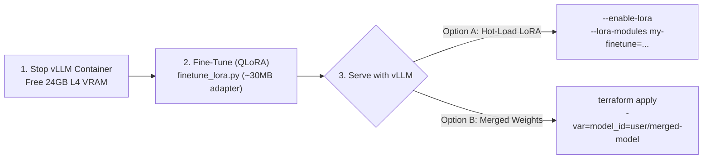

# Fine-Tuning Open-Weight Models with QLoRA + Serving on vLLM

This example shows the complete loop from **fine-tuning** an open-weight model (`Qwen/Qwen2.5-3B-Instruct` by default, or any preset from [`variables.tf`](../../variables.tf)) using 4-bit QLoRA (`peft` + `trl`) to **serving** it on vLLM.



## What's included

| File | Description |
|---|---|
| `finetune_lora.py` | CLI script using `transformers`, `peft`, `trl` (`SFTTrainer`), and 4-bit `bitsandbytes` QLoRA |
| `sample_dataset.jsonl` | 10-example healthcare/HIPAA compliance JSON-triage dataset in OpenAI `messages` chat format |
| `requirements.txt` | Python dependencies for QLoRA fine-tuning |

---

## 1. Run fine-tuning on your GCE L4 VM

> **Important:** Because vLLM pre-allocates 85–90% of GPU VRAM at startup, stop the `vllm` container before training so PyTorch can use the L4 GPU.

### Connect and stop vLLM

```bash
ZONE=$(terraform output -raw ssh_command | grep -oP 'zone=\K\S+')

# Copy the example folder to the VM
gcloud compute scp --recurse examples/finetune-lora vllm-server:~/finetune-lora --zone=$ZONE

# SSH into the VM
gcloud compute ssh vllm-server --zone=$ZONE
```

Once inside the VM:

```bash
# 1. Free GPU memory by stopping vLLM
sudo docker stop vllm
nvidia-smi

# 2. Create a Python virtual environment and install dependencies
sudo apt-get update && sudo apt-get install -y python3-venv python3-pip
python3 -m venv ~/finetune-venv
source ~/finetune-venv/bin/activate
pip install --upgrade pip
pip install -r ~/finetune-lora/requirements.txt
```

### Train a LoRA adapter

```bash
cd ~/finetune-lora

# Default: Qwen/Qwen2.5-3B-Instruct (ungated, fits easily on 1x L4 24GB)
python3 finetune_lora.py \
  --model-id Qwen/Qwen2.5-3B-Instruct \
  --dataset sample_dataset.jsonl \
  --output-dir ./outputs/qwen2.5-3b-lora \
  --epochs 3
```

For gated models (`Llama`, `Gemma`) or pushing directly to HuggingFace Hub, export your token first:

```bash
export HF_TOKEN=your_huggingface_token

python3 finetune_lora.py \
  --model-id google/gemma-3-4b-it \
  --dataset sample_dataset.jsonl \
  --output-dir ./outputs/gemma-3-4b-lora \
  --push-to-hub YOUR_HF_USER/gemma-3-4b-hipaa-lora
```

### Optional: Monitor training with TensorBoard via SSH port forwarding

Run training with `--report-to tensorboard`, start TensorBoard on the VM, and forward port `6006` from your local machine:

```bash
# On the remote VM:
python3 finetune_lora.py --report-to tensorboard --output-dir ./outputs/qwen2.5-3b-lora
tensorboard --logdir ./outputs/qwen2.5-3b-lora --port 6006 --bind_all
```

```bash
# On your local machine (new terminal):
gcloud compute ssh vllm-server --zone=$ZONE -- -N -L 6006:localhost:6006
# Open http://localhost:6006 in your local browser
```

> **Note on SSH port forwarding:** All code execution, PyTorch, and GPU workloads run 100% on the remote VM — only the TensorBoard web UI is displayed locally in your browser.

---

## 2. Serve your fine-tuned model in vLLM

### Option A — Multi-LoRA (hot-load adapter alongside base model)

vLLM can serve the base model and one or more LoRA adapters simultaneously on the same GPU.

#### Option A1: Via Terraform (adapter pushed to HuggingFace Hub)

From your local repo directory:

```bash
terraform apply -auto-approve \
  -var="model_preset=qwen2.5-3b-instruct" \
  -var="extra_vllm_args=--enable-lora --lora-modules my-finetune=YOUR_HF_USER/qwen2.5-3b-hipaa-lora"
```

*(If your Hub adapter or base model is private/gated, export `TF_VAR_hf_token="$HF_TOKEN"` first.)*

#### Option A2: Directly on the VM (using your local `./outputs/` directory)

If you haven't pushed the adapter to HuggingFace Hub, mount the local adapter directory into the `vllm` container:

```bash
sudo docker rm vllm

sudo docker run -d \
  --name vllm \
  --runtime=nvidia \
  --gpus all \
  --shm-size=4G \
  --restart unless-stopped \
  -p 8000:8000 \
  -v ~/finetune-lora/outputs/qwen2.5-3b-lora:/lora \
  vllm/vllm-openai:latest \
  --model Qwen/Qwen2.5-3B-Instruct \
  --port 8000 \
  --host 0.0.0.0 \
  --max-model-len 8192 \
  --gpu-memory-utilization 0.85 \
  --enable-lora \
  --lora-modules my-finetune=/lora
```

#### Test your fine-tuned adapter

Query `"model": "my-finetune"` (you can also query `"model": "Qwen/Qwen2.5-3B-Instruct"` on the exact same endpoint to compare base vs. fine-tuned output):

```bash
IP=$(terraform output -raw vm_external_ip)

curl http://$IP:8000/v1/chat/completions \
  -H "Content-Type: application/json" \
  -d '{
    "model": "my-finetune",
    "messages": [
      {"role": "user", "content": "Triage this healthcare compliance question and respond in JSON: What is HIPAA?"}
    ],
    "max_tokens": 200
  }'
```

---

### Option B — Merge weights and deploy as a standalone model

If you prefer a single merged model with zero LoRA overhead:

```bash
# 1. Train and merge into a standalone 16-bit model directory
python3 finetune_lora.py \
  --model-id Qwen/Qwen2.5-3B-Instruct \
  --output-dir ./outputs/qwen2.5-3b-lora \
  --merge-and-save ./outputs/qwen2.5-3b-merged

# 2. Upload merged weights to HuggingFace Hub
export HF_TOKEN=your_huggingface_token
huggingface-cli upload YOUR_HF_USER/qwen2.5-3b-hipaa-merged ./outputs/qwen2.5-3b-merged
```

Then deploy cleanly from Terraform:

```bash
terraform apply -auto-approve -var="model_id=YOUR_HF_USER/qwen2.5-3b-hipaa-merged"
```
